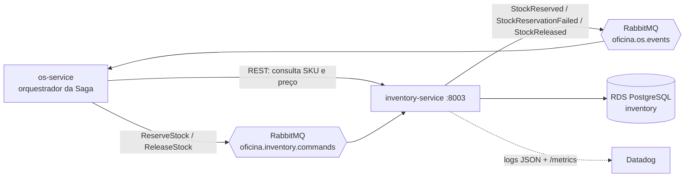

# Estoque e Catálogo (`inventory-service`)

Microsserviço dono das **peças e serviços da oficina**: catálogo com preço,
saldo de estoque e reserva de peças para cada OS. Na Saga, ele é o passo que
"separa as peças na prateleira" e, se a OS for desfeita, devolve as peças ao estoque.
Tem banco PostgreSQL próprio; o OS consulta o catálogo só pela API HTTP.

## 1. Arquitetura do serviço



Por que um serviço separado:

- **Concorrência de saldo:** duas OS disputando a última peça é o ponto mais sensível do domínio. A reserva usa `SELECT ... FOR UPDATE` dentro de uma transação local, e isso fica isolado num banco que só o Inventory toca.
- **Compensação simples e segura:** a reserva é idempotente por `order_id` (repetir o comando não baixa o estoque duas vezes) e a liberação também (`ALREADY_RELEASED` na segunda vez). O orquestrador pode reenviar comandos depois de um timeout sem medo de duplicar.
- **Catálogo como fonte de preço:** o OS congela nome e preço do catálogo no momento da abertura da OS, e o orçamento do Billing usa esses valores.

## 2. Papel na Saga

| Comando recebido | Resultado publicado | Quando acontece |
|---|---|---|
| `ReserveStock` | `StockReserved` | Pagamento confirmado e peças disponíveis |
| `ReserveStock` | `StockReservationFailed` (`reason`) | Peça inexistente, inativa ou sem saldo. O OS inicia a compensação (estorno no Billing) |
| `ReleaseStock` | `StockReleased` | OS cancelada depois da reserva (compensação) |

Toda mensagem publicada repassa o `correlation_id` recebido, então uma OS pode ser seguida de ponta a ponta nos logs. Mensagens que falham no processamento vão para `oficina.inventory.commands.dlq` (dead-letter com `x-dead-letter-exchange`).

## 3. Endpoints

A especificação completa está em [`openapi.json`](./openapi.json) e em `/docs` com o serviço rodando.

| Método | Rota | Quem chama | O que faz |
|---|---|---|---|
| PUT | `/parts/{sku}` | Admin | Cadastra/atualiza peça, preço e saldo |
| PUT | `/services/{sku}` | Admin | Cadastra/atualiza serviço e preço de mão de obra |
| GET | `/parts` (`?low_stock=true`) | Admin | Lista peças; com o filtro, só as que estão no limite de alerta |
| GET | `/parts/{sku}` | Usuário autenticado | Consulta peça |
| GET | `/internal/parts/{sku}`, `/internal/services/{sku}` | OS (token interno) | Validação de SKU e preço na abertura da OS |
| POST | `/reservations` | OS (token interno) | Reserva atômica e idempotente por `order_id` |
| GET | `/reservations/{order_id}` | Admin | Mostra o que está reservado para uma OS |
| DELETE | `/reservations/{order_id}` | OS (token interno) | Libera a reserva (compensação idempotente) |
| GET | `/health`, `/health/live`, `/metrics` | Kubernetes / Datadog | Probes e métricas |

## 4. Observabilidade

- **Logs JSON** com `correlation_id`, rota, status e latência de cada requisição (o mesmo formato do OS).
- **`/metrics`** traz, além das métricas HTTP e de eventos, as métricas de negócio:
  - `stock_reservations`: `reserved`, `failed` e `released`. Muitas falhas de reserva indicam falta de peça ou problema de cadastro.
  - `low_stock_alerts` por SKU: incrementa quando uma reserva deixa a peça com saldo ≤ `LOW_STOCK_THRESHOLD` (padrão 5). Cada ocorrência também gera um log `WARNING low_stock`, que pode virar monitor no Datadog.

## 5. Configuração

| Variável | Uso |
|---|---|
| `DATABASE_URL` | PostgreSQL exclusivo do Inventory |
| `MESSAGING_ENABLED`, `RABBITMQ_URL` | Consumo de comandos e publicação de eventos |
| `INTERNAL_SERVICE_TOKEN` | Mesmo valor do OS. O serviço deve ficar privado no cluster |
| `JWT_SECRET_KEY`, `JWT_ALGORITHM` | Validam os tokens emitidos pela Lambda |
| `LOW_STOCK_THRESHOLD` | Saldo a partir do qual a peça entra no alerta (padrão 5) |

No Kubernetes, `RABBITMQ_URL` vem do secret `microservices-secrets` (chave `rabbitmq-url`). O namespace também precisa do secret `ghcr-pull` para baixar a imagem privada do GHCR.

## 6. Execução local, testes e cobertura

```bash
docker compose up --build          # http://localhost:8003/docs
uv sync --dev
uv run pytest --cov=app --cov-report=term-missing --cov-fail-under=80
uv run ruff check --select E4,E7,E9,F app tests
```

Fora do Docker, rode `alembic upgrade head` antes de subir o servidor.

### Evidência de cobertura (93% > 80% exigido)

```text
Name                   Stmts   Miss  Cover
------------------------------------------
app/__init__.py            0      0   100%
app/auth.py               28      0   100%
app/main.py              230     20    91%
app/messaging.py          78      6    92%
app/observability.py      59      3    95%
------------------------------------------
TOTAL                    395     29    93%
19 passed
```

## 7. Infraestrutura e CI/CD

- `infra/`: RDS PostgreSQL 16 exclusivo (privado). Valide com `terraform -chdir=infra init -backend=false && terraform -chdir=infra validate`. O apply exige backend de estado remoto e revisão do plano.
- `k8s/`: `deployment.yaml` (probes, secrets) e `migration-job.yaml`.
- `.github/workflows/ci-cd.yml`: testes com gate de 80%, Ruff, **SonarCloud obrigatório com Quality Gate** (`SONAR_TOKEN` precisa estar nos secrets do repo), validação do Terraform, build/push no GHCR e deploy no EKS.
